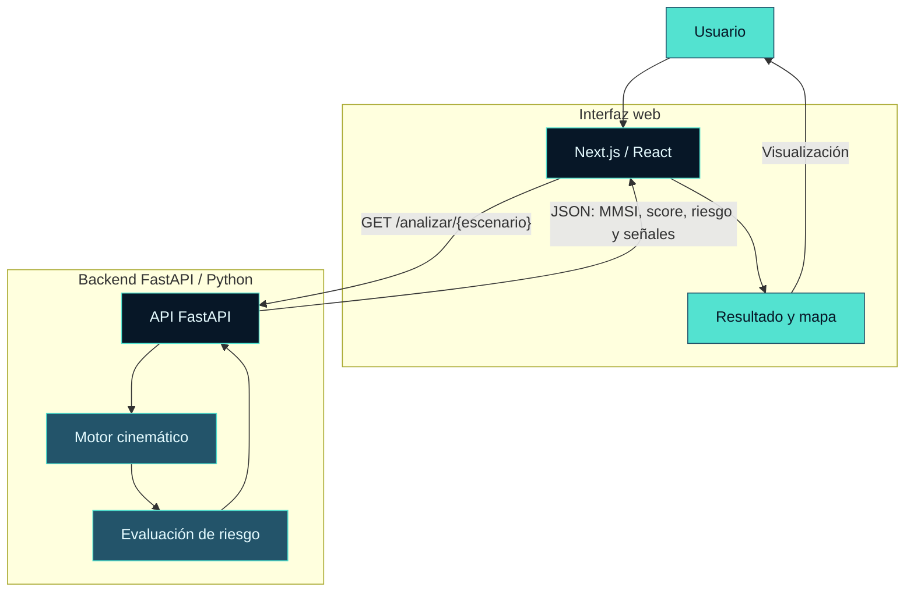

<div align="center">

<h1>IRIS — Maritime Intelligence &amp; Risk Identification System</h1>

<h3>Inteligencia marítima para identificar movimientos anómalos</h3>

<p><em>Cada señal cuenta. Cada anomalía merece ser investigada.</em></p>

<p>El Guardián del Mar: un MVP académico que combina cálculos cinemáticos y reglas deterministas para analizar dos escenarios sintéticos de navegación y explicar sus señales de riesgo.</p>


<p><strong><a href="#solucion">Explorar la solución</a> · <a href="#arquitectura">Ver arquitectura</a> · <a href="#instalacion">Instalación</a></strong></p>

</div>

> [!WARNING]
> IRIS es un prototipo académico que utiliza escenarios sintéticos. Sus señales no demuestran actividades ilícitas ni sustituyen una evaluación marítima profesional. No es una herramienta operativa de vigilancia marítima.

---

<a name="desafio"></a>
## 🌊 01 / El desafío

### Convertir posiciones aisladas en señales comprensibles

Una secuencia de posiciones, horas e identificadores puede contener inconsistencias difíciles de interpretar sin contexto: desplazamientos incompatibles con la velocidad declarada, intervalos prolongados entre registros o cambios de identidad.

IRIS explora cómo transformar esos datos en una evaluación explicable. La pregunta que guía el MVP es: **¿qué señales aparecen al contrastar el movimiento calculado con los datos declarados?**

El análisis requiere cautela: una anomalía puede deberse a errores de datos, problemas de transmisión u otras causas que deben investigarse.

---

<a name="solucion"></a>
## 🛡️ 02 / La solución

### Calcular. Contrastar. Explicar.

IRIS conecta una interfaz web con una API y un motor Python. El usuario elige uno de los dos escenarios predefinidos y recibe un resultado con MMSI, señales, nivel de riesgo y un **Risk Score heurístico de 0 a 100**.

| Capacidad implementada | Comportamiento real |
|---|---|
| Análisis cinemático | Distancia Haversine entre posiciones consecutivas y velocidad media en nudos. |
| Reglas de detección | Diferencia de velocidad, superación de un umbral máximo, MMSI en una lista local e intervalo prolongado. |
| Consolidación del resultado | Suma de pesos por tramo, límite de 100 y clasificación BAJO, MEDIO o ALTO. |
| Visualización | Tarjetas, barra de score, señales y trayectoria con Leaflet sobre OpenStreetMap. |
| Explicación del resultado | Texto generado mediante plantillas condicionales en el frontend. |

**El score expresa una configuración de reglas; no es una probabilidad de delito ni una medida de precisión.** No intervienen modelos de Machine Learning ni una integración operativa con IA generativa.

---

<a name="funcionamiento"></a>
## 🔄 03 / Cómo funciona

### De un escenario a un resultado estructurado

1. El usuario selecciona **Normal** o **Sospechoso**.
2. El frontend solicita `GET /analizar/{escenario}` a la API.
3. FastAPI selecciona los registros sintéticos y llama al motor.
4. El motor calcula distancia, intervalo y velocidad entre registros consecutivos, y evalúa cuatro reglas.
5. Se suman los pesos, se limita el score a 100 y se asigna el nivel de riesgo.
6. La API devuelve JSON; la interfaz muestra el resultado y una trayectoria predefinida para el escenario seleccionado.

### Reglas y pesos

| Señal | Condición implementada | Peso por tramo |
|---|---|---:|
| Anomalía cinemática | Diferencia absoluta entre velocidad calculada y declarada **> 5 nudos**. | +30 |
| Movimiento físicamente imposible | Velocidad calculada **> 30 nudos**. | +40 |
| MMSI sospechoso | MMSI del siguiente registro incluido en la lista local `["123456789"]`. | +20 |
| Going dark | Intervalo entre registros **> 3.600 segundos**. | +20 |

El nombre «Movimiento físicamente imposible» es la etiqueta del código: superar el umbral fijo de 30 nudos no demuestra imposibilidad física para toda embarcación. Del mismo modo, «Going dark» indica un intervalo prolongado; no confirma un apagado intencional del AIS.

**Clasificación:** BAJO: 0–29 · MEDIO: 30–69 · ALTO: 70–100.

Las señales se muestran sin duplicados, pero sus pesos se acumulan por cada tramo que activa la regla.

---

<a name="arquitectura"></a>
## 🏗️ 04 / Arquitectura

### Una interfaz, una API y un motor en memoria



Los nodos de cálculo y evaluación corresponden a funciones del mismo módulo Python; no son servicios independientes. Los escenarios se mantienen en memoria. No hay base de datos, cola de mensajes ni almacenamiento de resultados.

| Componente | Archivo | Responsabilidad |
|---|---|---|
| Interfaz | [iris-web/app/page.tsx](iris-web/app/page.tsx) | Selección, solicitud HTTP, tarjetas y explicación por plantillas. |
| Mapa | [iris-web/components/MapaIRIS.tsx](iris-web/components/MapaIRIS.tsx) | Trayectoria, marcadores y mapa base externo. |
| API | [iris-api/main.py](iris-api/main.py) | Endpoints y configuración CORS. |
| Motor | [iris-api/kinematics.py](iris-api/kinematics.py) | Registros sintéticos, cálculos, reglas y score. |

La API devuelve el resultado consolidado; **las coordenadas del mapa están duplicadas en el frontend**, no proceden de la respuesta JSON.

### Endpoints

| Método y ruta | Respuesta |
|---|---|
| `GET /` | Mensaje de funcionamiento de la API. |
| `GET /analizar/normal` | Resultado del escenario normal. |
| `GET /analizar/sospechoso` | Resultado del escenario sospechoso. |
| `GET /analizar/{otro_valor}` | Objeto con error y opciones; actualmente responde HTTP 200. |
| `GET /docs` | Documentación interactiva generada por FastAPI. |
| `GET /openapi.json` | Esquema OpenAPI generado por FastAPI. |

No existe un endpoint para cargar registros propios.

---

<a name="resultados"></a>
## 🧪 05 / Escenarios y resultados

### Dos casos sintéticos, resultados reproducidos

Ambos escenarios contienen tres registros fechados el **3 de septiembre de 2026**. Los siguientes resultados se obtuvieron ejecutando el motor con sus datos originales.

| Escenario | MMSI devuelto | Score | Nivel | Señales |
|---|---|---:|---|---|
| Normal | `111111111` | **0/100** | **BAJO** | Ninguna. |
| Sospechoso | `123456789` | **70/100** | **ALTO** | Anomalía cinemática, MMSI sospechoso y Going dark. |

### Por qué el escenario sospechoso suma 70

En el segundo tramo, el intervalo es de **9.000 segundos** y la distancia calculada es de aproximadamente **137,226 km**. La velocidad media resultante es de **29,638 nudos**, frente a los **1,68 nudos** declarados.

- La diferencia supera 5 nudos: **+30**.
- El siguiente registro contiene el MMSI de la lista local: **+20**.
- El intervalo supera 3.600 segundos: **+20**.
- La velocidad calculada no supera 30 nudos: **no se activa** «Movimiento físicamente imposible».

El MMSI cambia entre los registros del escenario sospechoso. El motor no valida que toda la secuencia pertenezca a una misma embarcación y devuelve el MMSI del último registro.

> [!NOTE]
> Estos casos demuestran el comportamiento de las reglas con entradas conocidas. No constituyen un dataset de validación ni permiten inferir precisión, sensibilidad o desempeño con tráfico marítimo real.

---

<a name="tecnologias"></a>
## 🛠️ 06 / Tecnologías

### Stack del MVP

| Capa | Tecnologías y dependencias declaradas |
|---|---|
| Motor | Python; módulos estándar `math` y `datetime`. |
| API | FastAPI y Uvicorn, sin versiones fijadas en `requirements.txt`. |
| Interfaz | Next.js `16.3.4`, React y React DOM `19.2.8`, TypeScript `^5`. |
| Estilos | Tailwind CSS `^4` y su integración PostCSS. |
| Cartografía | Leaflet `^1.9.4`; teselas OpenStreetMap e iconos desde unpkg. |
| Calidad estática | ESLint `^9` y `eslint-config-next` `16.3.4`. |

`react-leaflet` está declarado en las dependencias; el componente actual usa Leaflet directamente.

Consulta los manifiestos: [requirements.txt](iris-api/requirements.txt), [package.json](iris-web/package.json) y [package-lock.json](iris-web/package-lock.json).

---

<a name="instalacion"></a>
## 🚀 07 / Instalación y ejecución

### Preparar dos terminales

**Requisitos:** Python 3.12 como entorno de referencia del motor verificado; Node.js **≥ 20.9.0**, según el requisito declarado por Next.js en el lockfile, y npm. Necesitas acceso al repositorio privado para clonarlo.

La instalación descarga paquetes. El build utiliza fuentes de Google; el mapa carga teselas e iconos externos. IRIS no requiere claves de API ni un archivo `.env` en su configuración actual.

### 7.1 / Obtener el proyecto

```bash
git clone https://github.com/daliazapata/IRIS-Maritime-Intelligence.git
cd IRIS-Maritime-Intelligence
```

### 7.2 / Backend — primera terminal

Desde la raíz del proyecto, en Windows PowerShell:

```powershell
cd iris-api
python -m venv .venv
.\.venv\Scripts\python.exe -m pip install -r requirements.txt
.\.venv\Scripts\python.exe -m uvicorn main:app --reload --host 127.0.0.1 --port 8000
```

En macOS / Linux:

```bash
cd iris-api
python3 -m venv .venv
.venv/bin/python -m pip install -r requirements.txt
.venv/bin/python -m uvicorn main:app --reload --host 127.0.0.1 --port 8000
```

API: [http://127.0.0.1:8000](http://127.0.0.1:8000) · Swagger UI: [http://127.0.0.1:8000/docs](http://127.0.0.1:8000/docs).

### 7.3 / Frontend — segunda terminal

Desde la raíz del proyecto:

```bash
cd iris-web
npm ci
npm run dev -- --hostname localhost --port 3000
```

Abre **[http://localhost:3000](http://localhost:3000)** y mantén el backend en ejecución.

> [!IMPORTANT]
> El frontend tiene fijada la API en `http://127.0.0.1:8000` y CORS admite únicamente el origen `http://localhost:3000`. Abrir la interfaz con `127.0.0.1`, otro puerto o desde otro equipo requiere adaptar la configuración. Los comandos anteriores describen el arranque local; no representan un despliegue de producción validado.

Para solicitar una compilación de producción, desde `iris-web/`:

```bash
npm run build
npm run start -- --hostname localhost --port 3000
```

Ejecuta `start` solo si el build termina correctamente. La compilación no se ha verificado en esta revisión documental.

---

<a name="validacion"></a>
## ✅ 08 / Validación técnica

### Evidencia y alcance de la revisión

| Verificación | Resultado |
|---|---|
| Sintaxis de los dos archivos Python | Comprobada mediante compilación en memoria, sin generar `.pyc`. |
| Ejecución directa del motor | Normal: BAJO, 0; sospechoso: ALTO, 70, con las tres señales indicadas. |
| Cálculo de los tramos | Verificados distancia, intervalo y velocidad utilizados en la explicación de resultados. |
| Endpoints HTTP mediante TestClient | Intento interrumpido al no finalizar; sin resultado verificable. |
| Comunicación frontend–backend | Revisada en el código: `fetch`, JSON y origen permitido por CORS. |
| Compilación Next.js, lint y prueba completa en navegador | No ejecutados en esta revisión. |

La ejecución directa del motor se realizó con **Python 3.12.6**. El repositorio no incluye una suite de pruebas automatizadas.

Para reproducir la comprobación de los escenarios desde `iris-api/`, con el Python de tu entorno:

```bash
python -B -c "from kinematics import analizar_escenario, escenario_normal, escenario_sospechoso; print(analizar_escenario(escenario_normal)); print(analizar_escenario(escenario_sospechoso))"
```

Con la API en ejecución, puedes comprobar manualmente:

- [Escenario normal](http://127.0.0.1:8000/analizar/normal).
- [Escenario sospechoso](http://127.0.0.1:8000/analizar/sospechoso).

Estas comprobaciones son funcionales y acotadas; no validan el desempeño del sistema con datos reales.

---

<a name="limitaciones"></a>
## ⚠️ 09 / Limitaciones

### Alcance académico y decisiones de diseño

| Limitación | Implicación |
|---|---|
| Dos escenarios fijos | No hay ingesta AIS en vivo, carga de archivos ni consultas a fuentes institucionales. |
| Reglas y pesos heurísticos | Los umbrales no están calibrados con datos reales ni diferenciados por tipo de embarcación. |
| Validación de entradas limitada | No se comprueban orden temporal, rangos geográficos ni continuidad del MMSI; intervalos no positivos producen velocidad 0. |
| Acumulación por tramo | La longitud de una trayectoria influye en el score; no existe normalización por número de registros. |
| Mapa definido en el cliente | Cambiar datos del backend no actualiza automáticamente las coordenadas del frontend. |
| Ejecución local | URL de API y CORS fijos; sin autenticación, persistencia ni controles de operación en producción. |
| Dependencias externas | El mapa y las fuentes necesitan servicios externos; las dependencias Python no están fijadas. |
| Validación parcial | No se ha comprobado aquí el build ni un flujo completo en navegador. |

El «informe para operador» es texto por plantillas. La función Python `generar_informe_ia` también construye texto local y no forma parte del flujo del endpoint; su nombre no implica una integración generativa.

---

<a name="proximos-pasos"></a>
## 🧭 10 / Próximos pasos

### Mejoras propuestas, todavía no implementadas

| Prioridad | Objetivo |
|---|---|
| Reproducibilidad | Fijar dependencias Python y verificar instalación, build y lint en un entorno limpio. |
| Pruebas | Añadir casos para límites, cronología, identidad, entradas inválidas y contrato API–frontend. |
| Configuración | Parametrizar URL de API y orígenes CORS según el entorno. |
| Coherencia de datos | Obtener la trayectoria desde la API y validar que los registros pertenezcan a la misma embarcación. |
| Validación del enfoque | Evaluar reglas con datos autorizados y criterios explícitos antes de proponer cualquier uso operativo. |
| Evolución del análisis | Estudiar otras reglas o modelos solo si existe evidencia que justifique su incorporación. |

Estas propuestas no describen capacidades disponibles ni compromisos de implementación.

---

<a name="licencia"></a>
## 📄 11 / Licencia y contexto del proyecto

### El Guardián del Mar

**IRIS — Maritime Intelligence & Risk Identification System** es un MVP académico desarrollado para **WomenCISO-MenCISO**, en el contexto del proyecto final **WomenCISO4 / MenCISO Gen 1**.

Esta presentación de portafolio conserva el carácter académico del trabajo y sus atribuciones. El código se distribuye bajo la **GNU Affero General Public License, versión 3 (AGPL-3.0)**. Consulta las condiciones completas en [LICENSE](LICENSE).

La cartografía base corresponde a **OpenStreetMap**, con atribución visible en el componente del mapa. Las bibliotecas y servicios externos mantienen sus propias licencias y condiciones.

<div align="center">

<strong>IRIS · El Guardián del Mar</strong>

<p><em>Cada señal cuenta. Cada anomalía merece ser investigada.</em></p>

</div>
